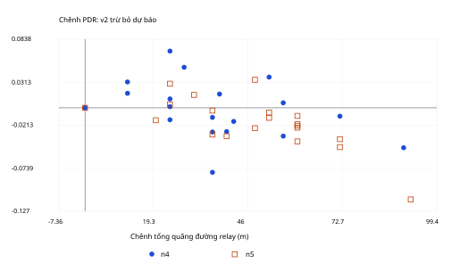
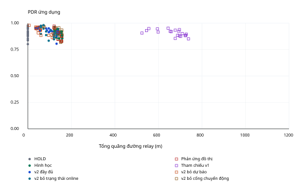
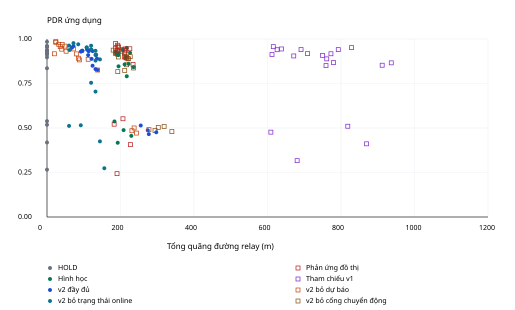

# Dự báo suy giảm dịch vụ và điều khiển relay UAV

## Mục tiêu và phạm vi

Báo cáo đánh giá một bộ điều khiển dự báo suy giảm dịch vụ cho chuỗi relay UAV khi hai đầu mút dần tách xa nhau. Thiết kế hướng đến dịch vụ ban đầu khỏe, nhưng tiêu chí này không được dùng để loại ca formal khởi đầu kém. Câu hỏi chính là phần dự báo của v2 có cải thiện tỷ lệ gói đến ứng dụng so với cùng bộ điều khiển bỏ dự báo hay không, và phải đổi bằng bao nhiêu quãng đường relay.

Pha formal có 384 ô kế hoạch; 384 ô có dữ liệu hợp lệ. Cờ lưới đầy đủ trong phân tích: có. Mỗi ô là một lần chạy của một vai trò trên một cặp hạt giống. Đơn vị suy luận là cặp hạt giống kịch bản; gói tin và cửa sổ thời gian không phải lần lặp độc lập.

Kết quả chính là âm: chênh PDR trung bình gộp v2 trừ bỏ dự báo là -0.00985667, trong khi tổng quãng đường relay tăng 41.2199 m/episode. Trong thử nghiệm đã chốt này, phần dự báo không mang lại cải thiện delivery so với bộ điều khiển chỉ phục hồi dịch vụ.

Phiên bản này dùng mô hình logistic và điều khiển chuyển động có giới hạn. Phạm vi thực nghiệm không bao gồm GNN hoặc RL và không thay thế các mục tiêu đó trong đề xuất ban đầu. Quãng đường được báo cáo trực tiếp; nghiên cứu không đo năng lượng hay thời gian bay.

## Bằng chứng điều tra và giới hạn cơ chế

Điều tra phát triển cho thấy tuyến OLSR và kết nối probe có thể còn tồn tại khi ứng dụng UDP đã mất dịch vụ. Các bản ghi ARP và các tầng vô tuyến giúp mô tả hiện tượng nhưng chưa xác định duy nhất một nguyên nhân RF hoặc ARP. Các bộ đếm drop có thể chồng lấp, gồm cả gói nghe lỏm; không cộng chúng thành số gói ứng dụng bị mất duy nhất.

Stage A/B lịch sử dùng commRange 243 m. Toàn bộ dữ liệu mới dùng 240 m. Khác biệt cấu hình này được giữ trong diễn giải; bằng chứng 243 m không được gắn nhãn thành kết quả 240 m. Các thay đổi vô tuyến dùng để chẩn đoán không được đưa vào phương pháp mới: OLSR, Wi-Fi và ARP vẫn theo cấu hình stock.

Bộ dự báo v1 nhắm đến mất cạnh probe và chỉ được dùng trong đối chứng path-service-v1-reference. Bộ dự báo v2 nhắm đến suy giảm dịch vụ quan sát được. Cả hai đều không cho xác suất một chuyển động đề xuất sẽ cải thiện PDR. Chuỗi hình học được chọn cũng không ép OLSR đi qua chuỗi đó; các sai khác tuyến và bằng chứng năm giây sau can thiệp được giữ như trace cơ chế, không phải chứng minh trung gian nhân quả.

## Giao thức và phân tách dữ liệu

Hai cấu hình là n4/.15 và n5/.10, nguồn ở node 0 và đích ở node cuối. Mỗi episode có warmup 10 s, 240 khoảng điều khiển một giây và 241 frame. Tải UDP là 256 kbps, gói 512 B, probe 20 Hz; không thêm tải nền. Mission gradual bắt đầu ở bước 30 với tốc độ 1 m/s; static dùng bước 1000. Phần điều khiển không được đọc nhãn kịch bản hoặc tương lai mission.

Phân tách đã chốt trước khi thu thập.

| Pha | Số episode | Vai trò và phân tách |
| --- | --- | --- |
| Train | 96 | HOLD + hình học; 12 cặp/cấu hình |
| Calibration | 48 | 6 cặp/cấu hình; chỉ HOLD dùng fit Platt |
| Development | 32 | 4 cặp/cấu hình; chẩn đoán giữ riêng |
| Pilot | 48 | 8 vai trò; 2 cặp gradual + 1 static/cấu hình |
| Formal | 384 | 8 vai trò; 20 cặp gradual + 4 static/cấu hình |

Các ID layout và radio được kiểm toán riêng để tránh giao nhau giữa các pha, giữa cấu hình và giữa static/gradual formal. Trong cùng pha thu thập, chỉ các phép ghép chính sách/ngữ cảnh được khai báo mới dùng lại cặp. Không thay hạt giống vì PDR thấp, không arm, không suy giảm hoặc không có outage. Pilot kiểm tra kỹ thuật và không được gộp vào suy luận formal.

HOLD không chuyển động; reactive là phản ứng với đồ thị; geometry luôn điều khiển hình học theo bản cũ. Đối chứng v1 giữ nguyên controller, model, default method và motion scaling đã được chấp nhận; đây là bản path-service-control-v1 chính xác, không phải biến thể đã fit lại hoặc predictor chuyển miền. Bốn vai trò còn lại là v2 đầy đủ, bỏ dự báo, bỏ trạng thái dịch vụ online và bỏ nhóm cổng chuyển động. Bỏ trạng thái online vẫn giữ đặc trưng dịch vụ trong predictor; bỏ cổng chuyển động là ablation gộp, không quy hiệu ứng cho từng cổng.

## Dịch vụ, dự báo và bộ điều khiển

PDR ứng dụng bằng tổng gói sink nhận chia tổng gói ứng dụng chào tại cùng ranh giới dừng. Số phát IP và FlowMonitor được giữ riêng; sai khác sink/FlowMonitor được trình bày chứ không tự loại episode. Không thêm thời gian xả gói. Frame khởi tạo được đối soát nhưng không trở thành cửa sổ một giây đầy đủ.

Tỷ lệ A5 lấy tổng arrivals chia tổng offers trên năm cửa sổ hợp lệ, không lấy trung bình các tỷ lệ. Gói đến muộn có thể làm tỷ lệ cửa sổ lớn hơn một. V2 chỉ arm sau ba lần liên tiếp có A5 và tỷ lệ injection ít nhất .95 cùng tuyến thành công; sớm nhất sau bảy cửa sổ đầy đủ. Suy giảm A5 dưới .90, nghiêm trọng dưới .50 và lỗi tuyến đều cần ba lần xác nhận. Outage là ba cửa sổ không có arrivals. Onset hồi cứu và confirmation nhân quả được lưu riêng.

Mô hình dùng đúng 25 đặc trưng nhân quả và hai chân trời 10/20 s, với normalization chỉ fit trên train và hiệu chuẩn độc lập bằng calibration HOLD. Nhãn yêu cầu toàn bộ cửa sổ tương lai cần thiết hợp lệ, chỉ dùng dữ liệu sau thời điểm dự báo. Các origin thiếu chân trời bị kiểm duyệt. Xác suất được chiếu đơn điệu theo chân trời. Dự báo trên quỹ đạo đã can thiệp có thể lệch phân phối so với dữ liệu quan sát.

Chuyển động v2 yêu cầu nguy cơ .50 trong hai frame đủ điều kiện và điều kiện khẩn H <= tau + 3 s + 2 s. Mỗi burst tối đa ba lệnh, rồi năm khoảng lệnh zero đầy đủ; tốc độ yêu cầu 2 m/s, deadband bắt đầu/dừng 3/1 m. Giao thức giả định tối đa simulator 8 m/s, ngân sách 400 m/relay và tách biệt 5 m. Giới hạn có thể làm phản ứng chậm; chúng không được đổi sau khi xem formal.

Kế hoạch phải có chuyển động dương, giảm hop lớn nhất trên cùng chuỗi ít nhất 2 m và tỷ số giảm hop/tổng chuyển động ít nhất .10, cùng kiểm tra toàn đích còn đủ ngân sách và an toàn. Tolerance là 1e-8. Không có veto một hop tăng quá 1 m và không coi commRange là ranh giới RF cứng. Bộ điều khiển bù đúng ABI chuyển động cũ; dịch chuyển thực tế được đo từ vị trí và travel counter.

## PDR và quãng đường di chuyển

Các bảng sau giữ trung bình per-episode từ phân tích đã đóng băng. Số nhận/chào là tổng bộ đếm được phân tích lưu sẵn, không phải cách thay thế trung bình per-episode bằng trọng số gói tin. Toàn bộ per-relay metres, mét trên 1000 gói chào và tỷ lệ ngân sách 400 m nằm trong all-planned-cells.csv.

PDR và chuyển động: hai đầu mút tách xa.

| Cấu hình | Vai trò | Hợp lệ | PDR TB | Tổng relay m TB | Nhận | Chào |
| --- | --- | --- | --- | --- | --- | --- |
| n4 | HOLD | 20 | 0.907247 | 0 | 272174 | 300000 |
| n4 | Phản ứng đồ thị | 20 | 0.90022 | 139.144 | 270066 | 300000 |
| n4 | Hình học | 20 | 0.90281 | 141.384 | 270843 | 300000 |
| n4 | Tham chiếu v1 | 20 | 0.907117 | 661.674 | 272135 | 300000 |
| n4 | v2 | 20 | 0.922617 | 100.2 | 276785 | 300000 |
| n4 | v2 bỏ dự báo | 20 | 0.92429 | 65.1 | 277287 | 300000 |
| n4 | v2 bỏ trạng thái dịch vụ online | 20 | 0.912043 | 100.4 | 273613 | 300000 |
| n4 | v2 bỏ cổng chuyển động | 20 | 0.908793 | 131.828 | 272638 | 300000 |
| n5 | HOLD | 20 | 0.829123 | 0 | 248737 | 300000 |
| n5 | Phản ứng đồ thị | 20 | 0.826633 | 204.225 | 247990 | 300000 |
| n5 | Hình học | 20 | 0.810517 | 205.93 | 243155 | 300000 |
| n5 | Tham chiếu v1 | 20 | 0.813677 | 741.689 | 244103 | 300000 |
| n5 | v2 | 20 | 0.824937 | 144.456 | 247481 | 300000 |
| n5 | v2 bỏ dự báo | 20 | 0.842977 | 97.1159 | 252893 | 300000 |
| n5 | v2 bỏ trạng thái dịch vụ online | 20 | 0.814783 | 110.47 | 244435 | 300000 |
| n5 | v2 bỏ cổng chuyển động | 20 | 0.818237 | 226.928 | 245471 | 300000 |

PDR và chuyển động: đối chứng tĩnh.

| Cấu hình | Vai trò | Hợp lệ | PDR TB | Tổng relay m TB | Nhận | Chào |
| --- | --- | --- | --- | --- | --- | --- |
| n4 | HOLD | 4 | 0.999 | 0 | 59940 | 60000 |
| n4 | Phản ứng đồ thị | 4 | 0.999 | 0 | 59940 | 60000 |
| n4 | Hình học | 4 | 0.999 | 2.66109 | 59940 | 60000 |
| n4 | Tham chiếu v1 | 4 | 0.999 | 0 | 59940 | 60000 |
| n4 | v2 | 4 | 0.999 | 0 | 59940 | 60000 |
| n4 | v2 bỏ dự báo | 4 | 0.999 | 0 | 59940 | 60000 |
| n4 | v2 bỏ trạng thái dịch vụ online | 4 | 0.999 | 0 | 59940 | 60000 |
| n4 | v2 bỏ cổng chuyển động | 4 | 0.999 | 0 | 59940 | 60000 |
| n5 | HOLD | 4 | 0.89165 | 0 | 53499 | 60000 |
| n5 | Phản ứng đồ thị | 4 | 0.89165 | 0 | 53499 | 60000 |
| n5 | Hình học | 4 | 0.89165 | 2.27728 | 53499 | 60000 |
| n5 | Tham chiếu v1 | 4 | 0.89165 | 0 | 53499 | 60000 |
| n5 | v2 | 4 | 0.89165 | 41.9958 | 53499 | 60000 |
| n5 | v2 bỏ dự báo | 4 | 0.89165 | 41.9958 | 53499 | 60000 |
| n5 | v2 bỏ trạng thái dịch vụ online | 4 | 0.89165 | 0 | 53499 | 60000 |
| n5 | v2 bỏ cổng chuyển động | 4 | 0.89165 | 107.538 | 53499 | 60000 |

So sánh chính là v2 trừ v2 bỏ dự báo. Hiệu ứng gộp cân bằng hai cấu hình. Khoảng 95% lấy từ bootstrap 10.000 lần trên khối kịch bản, giữ cả tám vai trò trong khối, RNG 20261112. Các số sau có dấu: lợi ích PDR dương có thể đi kèm tăng quãng đường.

So sánh chính: v2 trừ v2 bỏ dự báo; đơn vị PDR là tỷ lệ.

| Cấu hình | Chênh PDR | CI 95% | Chênh m | CI 95% m | Biên thiếu PDR |
| --- | --- | --- | --- | --- | --- |
| n4 | -0.00167333 | [-0.0162435; 0.0126404] | 35.1 | [25.6; 45] | [-0.00167333; -0.00167333] |
| n5 | -0.01804 | [-0.0325702; -0.00547667] | 47.3398 | [38.0795; 56.4] | [-0.01804; -0.01804] |
| Gộp cân bằng | -0.00985667 | [-0.0199118; -0.000181583] | 41.2199 | [34.65; 47.8704] | [-0.00985667; -0.00985667] |

Số cặp đủ/kế hoạch: n4 20/20; n5 20/20.

Các đối chứng khác: chênh v2 trừ đối chứng, gộp gradual. Các CI này có tính mô tả.

| Đối chứng | Chênh PDR | CI 95% | Chênh m | CI 95% m |
| --- | --- | --- | --- | --- |
| HOLD | 0.00559167 | [-0.0101305; 0.02402] | 122.328 | [106.19; 139.784] |
| Phản ứng đồ thị | 0.01035 | [-0.006457; 0.0300334] | -49.3568 | [-64.5137; -32.5513] |
| Hình học | 0.0171133 | [0.00363463; 0.030427] | -51.3291 | [-66.5514; -34.5044] |
| Tham chiếu v1 | 0.01338 | [-0.00212346; 0.0301151] | -579.354 | [-606.13; -552.162] |
| v2 bỏ trạng thái dịch vụ online | 0.0103633 | [-0.0104485; 0.0334583] | 16.8927 | [2.40419; 33.5018] |
| v2 bỏ cổng chuyển động | 0.0102617 | [-0.00361; 0.0242517] | -57.0501 | [-64.5109; -49.4256] |

## Suy giảm, cảnh báo và khôi phục

Các tỷ lệ sự kiện dùng số episode có dữ liệu và giữ số kế hoạch riêng. Thời điểm không có sự kiện bị kiểm duyệt phải, không đổi thành 0 và không bỏ khỏi thời lượng không sự kiện giới hạn 240 s. Bảng gọn dưới tập trung HOLD và hai vai trò của so sánh chính; toàn bộ tám vai trò, onset/confirmation, thời gian phục hồi và recovered-by-end được giữ trong CSV/JSON.

Khởi đầu HOLD trong formal: số arm trước/ở bước 20 và số chưa từng arm được báo riêng.

| Ngữ cảnh | Arm bước 20 | Mẫu quan sát | Mẫu kế hoạch | Chưa từng arm |
| --- | --- | --- | --- | --- |
| gradual n4 | 20 | 20 | 20 | 0 |
| gradual n5 | 16 | 20 | 20 | 0 |
| static n4 | 4 | 4 | 4 | 0 |
| static n5 | 3 | 4 | 4 | 0 |

Kiểm tra raw độc lập ghi nhận 43/48 HOLD arm trước/ở bước 20. Toàn bộ formal có 0 ca chưa từng arm khi kết thúc. Đây là kiểm tra chéo raw; bảng trên giữ các mẫu số theo ngữ cảnh/cấu hình từ phân tích chính.

Gate sáu HOLD pilot khỏe không trở thành tiêu chí chọn formal. Formal giữ các ca không arm trước bước 20 và các ca phải phục hồi khởi động. Đối với v2, startup restoration trước arm được phép sau xác nhận hỏng dịch vụ/tuyến; điều đó khác với bắt đầu forecast trước arm, vốn bị cấm. Không đồng nhất di chuyển trước arm với lỗi kỹ thuật hoặc dự báo sớm.

Năm ca v2 có chuyển động trước arm theo kiểm tra raw độc lập. Số khoảng có bất kỳ relay chuyển động được giữ tách khỏi số relay-khoảng; không gọi tổng relay-khoảng là giây trôi qua.

| Ca formal v2 | Bước arm | Khoảng có relay di chuyển trước arm | Forecast bắt đầu trước arm |
| --- | --- | --- | --- |
| n5-gradual-09 | 111 | 40 | 0 |
| n5-gradual-10 | 111 | 40 | 0 |
| n5-gradual-11 | 112 | 42 | 0 |
| n5-gradual-19 | 118 | 39 | 0 |
| n5-static-01 | 111 | 42 | 0 |

Audit raw đếm riêng từng relay ghi 406 relay-khoảng di chuyển trước arm ở v2. Tổng này không phải giây trôi qua; bảng per-episode dùng số khoảng có bất kỳ relay di chuyển và không cộng gộp relay.

Ca n5-static-01 có chuyển động phục hồi khởi động thực sự. Đây là chẩn đoán đối chứng tĩnh cần giữ trong kết quả, không thể mô tả toàn bộ static v2 là zero motion. Các ca này vẫn tham gia phân tích theo kế hoạch; subgroup HOLD arm trước/ở bước 20 chỉ có tính mô tả.

Suy giảm và outage ở so sánh chính; thời lượng tính từ cửa sổ traffic đầy đủ đầu tiên.

| Ngữ cảnh | Vai trò | Quan sát | Kế hoạch | Suy giảm | Outage | Giây chưa giảm TB |
| --- | --- | --- | --- | --- | --- | --- |
| gradual n4 | HOLD | 20 | 20 | 20 | 1 | 144.1 |
| gradual n4 | v2 | 20 | 20 | 20 | 0 | 142.5 |
| gradual n4 | v2 bỏ dự báo | 20 | 20 | 20 | 0 | 144.1 |
| gradual n5 | HOLD | 20 | 20 | 20 | 7 | 117.65 |
| gradual n5 | v2 | 20 | 20 | 20 | 5 | 117.05 |
| gradual n5 | v2 bỏ dự báo | 20 | 20 | 20 | 4 | 117.65 |
| static n4 | HOLD | 4 | 4 | 0 | 0 | 240 |
| static n4 | v2 | 4 | 4 | 0 | 0 | 240 |
| static n4 | v2 bỏ dự báo | 4 | 4 | 0 | 0 | 240 |
| static n5 | HOLD | 4 | 4 | 1 | 1 | 181 |
| static n5 | v2 | 4 | 4 | 1 | 1 | 181 |
| static n5 | v2 bỏ dự báo | 4 | 4 | 1 | 1 | 181 |

Endpoint phụ: chênh trung bình ghép cặp v2 trừ bỏ dự báo trong gradual. Chênh chỉ báo nhị phân là chênh nguy cơ; mẫu ghép đủ và các giá trị riêng được giữ trong secondary_contrasts.json.

| Endpoint | n4 chênh | n4 CI 95% | n5 chênh | n5 CI 95% |
| --- | --- | --- | --- | --- |
| Arm trước/ở bước 20 | 0 | [0; 0] | 0 | [0; 0] |
| Chưa từng arm | 0 | [0; 0] | 0 | [0; 0] |
| Phục hồi khởi động | 0 | [0; 0] | 0 | [0; 0] |
| Lần bắt đầu forecast | 2.25 | [1.65; 2.9] | 2.45 | [1.9; 3] |
| Lần bắt đầu phục hồi | 0.55 | [-0.3; 1.4] | 1.5 | [0.85; 2.3] |
| Giây lệnh di chuyển | 8.25 | [6.1; 10.45] | 11.85 | [9.55; 14.1] |
| Giây di chuyển thực | 8.25 | [6.1; 10.45] | 11.85 | [9.55; 14.1] |
| Giây di chuyển trước arm | 0 | [0; 0] | 0 | [0; 0] |
| Giây cooldown | 13.95 | [10.2; 17.95] | 19.4 | [15.3; 23.3] |
| Giây suy giảm đã xác nhận | 2.9 | [-3.65; 9.35] | 9.45 | [4.95; 14.35] |
| Có suy giảm | 0 | [0; 0] | 0 | [0; 0] |
| Có suy giảm nghiêm trọng | 0.05 | [-0.15; 0.25] | 0.15 | [-0.05; 0.35] |
| Có outage | 0 | [0; 0] | 0.05 | [0; 0.15] |
| Có lỗi tuyến | -0.15 | [-0.35; 0] | -0.1 | [-0.35; 0.15] |
| Giây chưa suy giảm giới hạn | -1.6 | [-4.8; 0] | -0.6 | [-1.8; 0] |
| Giây chưa nghiêm trọng giới hạn | -4.1 | [-13.55; 5.3] | -2.75 | [-12.25; 7.15125] |
| Giây chưa outage giới hạn | 0 | [0; 0] | -2.8 | [-8.4; 0] |
| Giây chưa lỗi tuyến giới hạn | 2.05 | [-5.25; 9.75] | 3.55 | [-3.4; 11.5] |

Thời lượng từng đợt phục hồi, kiểm duyệt và recovered-by-end chỉ được diễn giải trong nhóm episode đã xác nhận sự kiện; chúng không thay cho PDR toàn bộ hạt giống. Tỷ lệ cửa sổ A5 dưới .90 đi kèm mẫu số cửa sổ đánh giá được và số cửa sổ unknown. Các số đó, burst, cooldown, stop reason, safety/budget rejection và di chuyển trước arm được giữ theo episode trong all-planned-cells.csv.

Kiểm định dự báo dùng quỹ đạo heldout HOLD, trên origin đã arm và đang khỏe với toàn bộ tương lai cần thiết hợp lệ. Trên quỹ đạo đã điều khiển, không có sự kiện sau hành động không đủ để gọi cảnh báo là sai. Cơ hội từ replay bóng trên HOLD được ghi riêng, không phải chuyển động đã thực hiện hoặc lợi ích hành động.

Dự báo HOLD theo chân trời; hàng thời gian không phải replicate độc lập.

| H (s) | Hàng đủ | Kiểm duyệt | Cặp hạt giống | Tỷ lệ dương | Brier | PR-AUC |
| --- | --- | --- | --- | --- | --- | --- |
| 10 | 8243 | 142 | 48 | 0.0883174 | 0.0637063 | 0.415308 |
| 20 | 8046 | 339 | 48 | 0.186055 | 0.0868396 | 0.693516 |

Brier/log loss và bất định cụm episode; precision/recall dùng ngưỡng đã chốt.

| H (s) | CI 95% Brier | Log loss | CI 95% log loss | Precision | Recall |
| --- | --- | --- | --- | --- | --- |
| 10 | [0.0521142; 0.0751056] | 0.199974 | [0.16524; 0.234411] | 0.692308 | 0.0494505 |
| 20 | [0.0711895; 0.102457] | 0.257064 | [0.213321; 0.300048] | 0.683036 | 0.408818 |

Reliability HOLD: các bin cố định [0,.2), [.2,.4), [.4,.6), [.6,.8), [.8,1]. Bin rỗng giữ giá trị không xác định.

| H (s) | Cận dưới | Cận trên | Số hàng | Xác suất TB | Tỷ lệ sự kiện |
| --- | --- | --- | --- | --- | --- |
| 10 | 0 | 0.2 | 7232 | 0.0335309 | 0.052406 |
| 10 | 0.2 | 0.4 | 840 | 0.272843 | 0.294048 |
| 10 | 0.4 | 0.6 | 160 | 0.469494 | 0.58125 |
| 10 | 0.6 | 0.8 | 11 | 0.653084 | 0.818182 |
| 10 | 0.8 | 1 | 0 | không xác định | không xác định |
| 20 | 0 | 0.2 | 5654 | 0.0374642 | 0.0141493 |
| 20 | 0.2 | 0.4 | 1069 | 0.290603 | 0.529467 |
| 20 | 0.4 | 0.6 | 780 | 0.493011 | 0.584615 |
| 20 | 0.6 | 0.8 | 372 | 0.671367 | 0.653226 |
| 20 | 0.8 | 1 | 171 | 0.881881 | 0.888889 |

Cảnh báo HOLD: giữ mẫu số, trường hợp ngoài risk set và kiểm duyệt.

| Chỉ số | Giá trị |
| --- | --- |
| Sự kiện phát hiện | 54 |
| Mẫu số sự kiện đủ điều kiện | 139 |
| Độ nhạy sự kiện | 0.388489 |
| Sự kiện ngoài risk set | 23 |
| Cảnh báo sai | 42 |
| Cảnh báo đánh giá được | 111 |
| Cảnh báo kiểm duyệt | 16 |
| Tỷ lệ cảnh báo sai | 0.378378 |
| Cảnh báo sai/100 phút đủ điều kiện | 30.0537 |
| Cảnh báo dương lặp lại | 15 |

Các dự báo liên tiếp vượt .50 được gộp thành cảnh báo. Đúng/sai dùng nhãn future-only tại chân trời ngắn nhất vượt ngưỡng khi bắt đầu. Mỗi sự kiện chỉ góp tối đa một lần vào độ nhạy và lead time; cảnh báo dương thừa giữ riêng. Lead warning và lead từ cơ hội bóng được giữ tách trong forecasts.json. Lead bằng hoặc dưới zero không phải cảnh báo trước. Reliability bins, origin, cảnh báo, lead và cơ hội bóng đầy đủ được giữ kèm.

## Bất định, thất bại và kết quả âm

Kết quả formal không lặp lại lợi ích mô tả trong pilot nhỏ. Chênh PDR chính gộp là -0.00985667 với CI 95% [-0.0199118; -0.000181583]; quãng đường tăng 41.2199 m với CI 95% [34.65; 47.8704]. Đây là kết quả âm của phần forecast trong phương pháp cố định. Nó không chứng minh mọi dự báo đều vô ích, cũng không cho phép chọn lại seed, threshold hoặc cấu hình từ kết quả này.

Ước lượng chính dùng mọi hạt giống đã lên kế hoạch và báo rõ các cặp đủ dữ liệu. Cờ lưới đầy đủ: có. Biên nhạy cảm PDR khi thiếu dữ liệu được giữ ở bảng so sánh chính bằng cách chặn PDR thiếu trong [0,1]. Nếu có ô không thể phục hồi, chỉ các ước lượng cặp đủ mới có dữ liệu đầy đủ; không gọi cả lưới là hoàn tất.

Pooled gradual là trung bình cân bằng hai cấu hình, không cân theo số gói hoặc số cửa sổ. Chênh từng cặp, gồm điểm âm và zero, được giữ nguyên trong contrasts.json. Ngưỡng chênh PDR ít nhất .01 là cờ mô tả thực hành, không phải ngưỡng kiểm định chọn sau kết quả. Các so sánh phụ có tính thăm dò; không diễn giải nhiều CI như một loạt chứng minh ưu thế chưa điều chỉnh.

Static formal chỉ có bốn cặp/cấu hình. Kích hoạt hoặc chuyển động ở static là chẩn đoán đối chứng âm; một cảnh báo không tự thành sai nếu dịch vụ thực sự suy giảm. Không có outage, không arm, khôi phục chưa xong, dự báo không xác định và hiệu ứng âm đều là kết quả cần giữ.

Pilot kỹ thuật trước formal được lưu riêng: pilot đầu có lỗi adapter collector, và audit v002 báo sai khác replay do so sánh tuple/list. V003 sửa bộ so sánh rồi đọc lại cùng raw pilot; bản v002 và đầu ra lỗi không bị xóa. Audit development bất đồng bộ ban đầu thiếu mã thoát trực tiếp. Hoàn tất tệp và manifest đã xác minh không thay thế bằng chứng exit 0; giới hạn hồ sơ này vẫn còn.

Chronology giữ riêng tám lần mô phỏng đã chạy trong pilot đầu: bốn vai trò cũ hoàn tất và bốn ca v2 lỗi collector. Chúng không được cộng vào các episode hợp lệ của pilot sửa. Nhóm 96 wrapper train đầu tiên lỗi preimport trước khi simulator khởi chạy là lần thử hạ tầng, không phải 96 lần mô phỏng. Adapter collector được sửa và duyệt trước formal; nguồn thu thập, nguồn thực thi và ranh giới đóng băng được ghi riêng trong provenance.

## Giới hạn và khả năng tái lập

Hạt giống kịch bản chung giúp ghép cặp bố trí và radio. Chuyển động khác nhau làm đổi lịch sự kiện và tiêu thụ RNG; không có cặp đối chứng ngẫu nhiên ở từng gói tin. Dự báo quan sát không nhận diện hiệu quả chuyển động phản thực. Kết quả trong hai chuỗi nhỏ và tải đã chốt không bảo đảm ưu thế ở mạng khác, không xác lập tính mới và không cho hiệu quả năng lượng.

Cầu pipe điều khiển tập trung là đồng bộ: simulator ngừng tiến triển khi Python tính quyết định. Median/p95/max cho feature, predictor, planner, decision và thời gian tiến trình nằm trong timing.json; các quần thể timing khác nhau được giữ riêng. Chúng không phải trễ vô tuyến/control-plane đã mô hình hóa. Khoảng định tuyến 3 s là giả thuyết lập kế hoạch, không phải phép đo đáp ứng thời gian thực hoặc kiểm chứng triển khai phân tán.

PDF này là bản biên tập chỉ thay lời văn và bố cục. Bản dựng đầu tiên từ reporting.py đã đóng băng vẫn giữ nguyên. tables/analysis.json giữ nguyên byte phân tích, engineering.json giữ đầu vào kỹ thuật gọn, và numerical-source-ledger.json ghi con trỏ nguồn cho các giá trị được in. Các bảng per-cell, cảnh báo, kiểm duyệt, đường dẫn và timing đầy đủ nằm trong CSV/JSON kèm theo.

reproduce.json và retained-inventory.json giữ root gốc cùng ánh xạ tương đối đến dữ liệu, source, binary, model, method, protocol, runtime/dependency và exact argument array. Dữ liệu thô được giữ trong các gói/inventory đã xác minh, không nằm hết trong thư mục PDF. Tệp còn thiếu phải được nêu rõ; không gọi gói là đầy đủ nếu thiếu raw cần thiết. README chỉ hướng dẫn validate/analyze/report vào đích mới và không tự chạy lại mô phỏng hoặc fit.
